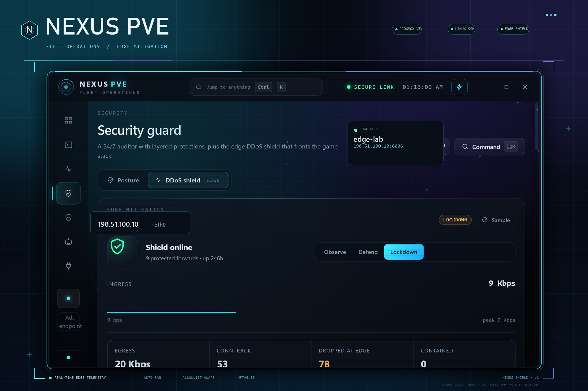
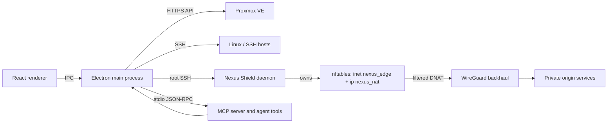
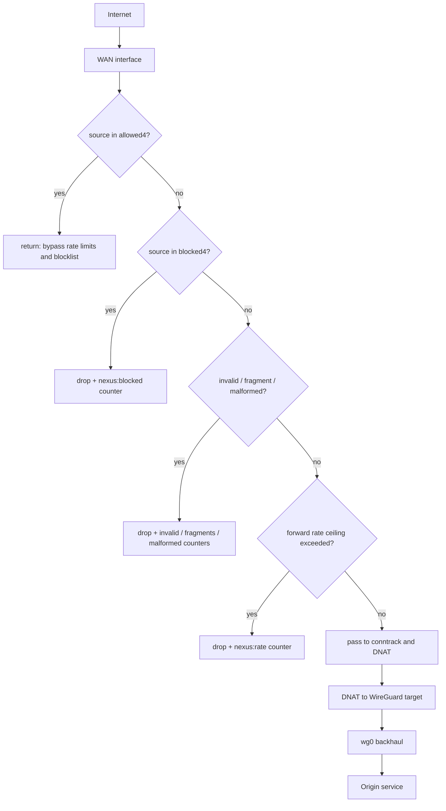

# Nexus PVE

<p align="center">
  
</p>

<p align="center">
  <strong>Fleet operations for Proxmox VE, Linux hosts, and the edge.</strong><br />
  Live telemetry, backups, guest control, security auditing, an nftables DDoS shield, and approval-gated agent pipelines in one portable desktop console.
</p>

<p align="center">
  <a href="LICENSE"></a>
  
  
  
</p>

> **Documentation image:** the hero uses documentation addresses from the RFC 5737 ranges. It does not show a live edge address. The project ships with fictional demo data and no credentials, private keys, or real infrastructure addresses.

---

## Contents

- [Why Nexus PVE](#why-nexus-pve)
- [At a glance](#at-a-glance)
- [Get Nexus PVE](#get-nexus-pve)
- [Quick start](#quick-start)
- [Screens and features](#screens-and-features)
- [Edge DDoS shield](#edge-ddos-shield)
  - [Architecture and trust boundary](#architecture-and-trust-boundary)
  - [The packet path](#the-packet-path)
  - [Modes and escalation](#modes-and-escalation)
  - [Automatic bans](#automatic-bans)
  - [Allowlist guarantees](#allowlist-guarantees)
  - [Manual controls](#manual-controls)
  - [Configuration reference](#configuration-reference)
  - [Install and cutover](#install-and-cutover)
  - [Telemetry and journal](#telemetry-and-journal)
  - [Incident runbook](#incident-runbook)
  - [Threat model and limits](#threat-model-and-limits)
  - [DDoS regression tests](#ddos-regression-tests)
- [Linux and SSH fleet](#linux-and-ssh-fleet)
- [Security guardian](#security-guardian)
- [Backup studio](#backup-studio)
- [Agent and MCP pipelines](#agent-and-mcp-pipelines)
- [Connections and secrets](#connections-and-secrets)
- [Architecture](#architecture)
- [Build and test](#build-and-test)
- [Repository layout](#repository-layout)
- [Operations](#operations)
- [Troubleshooting](#troubleshooting)
- [Security model](#security-model)
- [Limitations](#limitations)
- [Contributing](#contributing)
- [License](#license)

---

## Why Nexus PVE

Most Proxmox tooling stops at the hypervisor. Nexus PVE treats the surrounding fleet as part of the same operational surface:

- **One fleet view.** Proxmox nodes and Linux/SSH servers are rendered together, with CPU, memory, swap, root filesystem, load, storage, disk health, network, uptime, and RRD history.
- **The edge is part of the console.** The DDoS shield is not a mock panel. It is a separate daemon on a designated Linux edge host, controlled over SSH, with a loopback-only API and nftables as the data plane.
- **Consequential work is gated.** VM power actions, snapshot rollback/deletion, backup restore, security enforcement, and edge installation are confirmed. Pipelines pause for a human before destructive steps.
- **Local-first by default.** Host configuration, encryption keys, run history, and audit records live in the per-user application data directory. There is no required cloud account or hosted control plane.
- **Portable when packaged.** The Windows target is a single portable executable with no installer and no Node.js runtime requirement.

The result is a console for a small but real fleet: a Proxmox cluster, a few Linux machines, a WireGuard backhaul, and an edge relay that needs to stay up while the desktop app is closed.

## At a glance

| Area | Implementation |
| --- | --- |
| Product | Nexus PVE `1.0.10` |
| Desktop shell | Electron 33, React 18, TypeScript, Vite |
| Desktop target | Windows 10/11 x64 portable executable |
| Proxmox access | HTTPS API with token or password authentication, optional TLS verification |
| Linux access | SSH keys or stored passwords; systemd, filesystem, service, and security inspection |
| SSH key control | Encrypted Ed25519 vault, per-host authorized_keys inventory, trust baseline, deploy/revoke, and an opt-in 24/7 enforcement watcher |
| Edge shield | Python 3.10+ daemon, nftables, conntrack, systemd |
| Edge control | Root SSH from the app; loopback-only bearer-token API on the edge |
| Secrets | AES-256-GCM vault in the per-user data directory |
| Automation | Built-in and JSON pipelines, MCP server, confirmation-gated destructive tools |
| Audit | Append-only tool audit and hash-chained security journal |
| License | GNU General Public License v3.0 only |

## Get Nexus PVE

### Portable build

Prebuilt portable artifacts are published on the repository's [Releases](../../releases) page. The latest stable build is [`v1.0.9`](https://github.com/nobody71004/nexus-pve/releases/tag/v1.0.9). The current source tree is `1.0.10`, published as a [pre-release](https://github.com/nobody71004/nexus-pve/releases/tag/v1.0.10).

The portable target is Windows 10/11 x64. It requires no installer and no system Node.js runtime. Verify the published download against the SHA-256 in the release notes; a local checkout that includes `NexusPVE-1.0.9-portable.exe` should match the published v1.0.9 hash.

### Release candidate 1.0.10

`1.0.10` is available as a GitHub pre-release.

- **Per-host GPU limits** — Each Proxmox node or Linux host can override any subset of the temperature limit, sustained-sample window, power percentage and VRAM percentage. Blank fields continue to inherit the global defaults.
- **VNC token hygiene** — The agent/MCP smoke suite now opens and closes a real loopback VNC bridge through a local SSH + RFB fixture and verifies that the session token never reaches session listings, close output, audit records or stderr.
- **Verification** — Preflight passes 4/4 edge tests, 87/87 agent/MCP checks, 28/28 GPU checks, 15/15 hardware checks, 26/26 SSH-key checks and 10/10 Agent Fabric checks. Packaged smoke passes 13/13 for both the unpacked app and the portable EXE.
- **Pre-release asset** — [`NexusPVE-1.0.10-portable.exe`](https://github.com/nobody71004/nexus-pve/releases/download/v1.0.10/NexusPVE-1.0.10-portable.exe) (117,559,054 bytes), SHA-256 `9a80596d4466fab8322debbb9993c0cb18aa5b14e77e3a0b95a85b09b560e0bb`. It is unsigned.

### Release 1.0.9

`v1.0.9` adds live GPU and server-hardware telemetry, sustained thermal alerts, and a unified machine-control surface for agents.

- **GPU telemetry** — Node and Linux host cards read NVIDIA `nvidia-smi` and AMD `amdgpu` sysfs data: utilization, VRAM, temperature, hotspot, memory temperature where exposed, power, fans, clocks, PCIe state, and compute processes. Unsupported devices and driver failures are reported explicitly instead of being shown as zero.
- **Server hardware** — Linux host cards expose CPU model and topology, memory, physical disks, NIC link state and counters, and thermal sensors. Proxmox node details read the PVE 8/9 sensor endpoints and use the CPU package sensor rather than the highest chassis reading.
- **Sustained thermal alerts** — GPU temperature limits are configurable with a consecutive-sample window (default 3, clamped to 2–20). A card is flagged `GPU THERMAL` only after the temperature stays at or above the threshold for the full window; one cool sample resets the streak.
- **Unified machine tools** — New `machines.list`, `machines.exec`, `machines.vnc.preflight`, `machines.vnc.setup`, `machines.vnc.open`, `machines.vnc.sessions`, and `machines.vnc.close` tools cover Linux SSH hosts and Proxmox nodes through one surface. Proxmox nodes without an SSH mapping are listed with a repair hint.
- **Fleet pipelines** — `console-sweep` and `fleet-command` run across the SSH inventory. `pipeline.run` accepts `host: "fleet"`, with an optional shell-free command.
- **Safety** — Command and VNC setup/open actions require `confirm: true`; VNC remains loopback-only behind authenticated SSH; session listings omit tokens; `sudoPassword` is redacted from audit summaries.
- **Verification** — Preflight passes 4/4 edge tests, 81/81 agent/MCP checks, 23/23 GPU checks, 15/15 hardware checks, 26/26 SSH-key checks, and 10/10 Agent Fabric checks. The packaged app smoke test passes 12/12 with 84 MCP tools.

| Asset | Size | SHA-256 |
|---|---|---|
| `NexusPVE-1.0.9-portable.exe` | 117,537,356 bytes | `4e1cf69b2821775c1b73a4012338007dd132755ce0fe0d111752b615d61ca06a` |

The portable asset and its SHA-256 are attached to the [`v1.0.9` release](https://github.com/nobody71004/nexus-pve/releases/tag/v1.0.9).

### Release 1.0.8

`v1.0.8` adds the SSH-key control plane and makes Proxmox node hardware reporting explicit instead of inferred.

- **SSH key control plane** — Generate Ed25519 keys in the encrypted local vault, deploy only the public half to a host, and switch that host to the managed private key. The **Security → SSH keys** tab shows each account's `authorized_keys`, fingerprints, file mode, managed/trusted/unmanaged classification, and the protected login key.
- **24/7 watcher and enforcement** — The watcher scans continuously and records a bounded journal. `sshkey.enforce` backs up `authorized_keys`, removes only unmanaged keys, and refuses if no managed or trusted key would remain. Automatic enforcement is explicit opt-in and the configured login key is always protected.
- **Accurate node hardware** — Node cards and `node.detail` now report physical cores, logical threads, sockets, memory, per-pool storage used/total, physical disk health, and GPUs discovered from Proxmox's PCI inventory. A missing `Sys.Audit` permission is reported as unavailable rather than shown as “no GPU”.
- **MCP surface** — New `sshkey.overview`, `sshkey.generate`, `sshkey.deploy`, `sshkey.scan`, `sshkey.trust`, `sshkey.policy`, `sshkey.enforce` (gated), and `sshkey.revoke` (gated) tools. Private key material never crosses IPC or MCP.
- **Verification** — Preflight covers 4 edge tests, 72/72 MCP/PVE checks, 25/25 real-SSH key lifecycle and watcher checks, and 10/10 agent-fabric checks.

The portable asset and its SHA-256 are attached to the [`v1.0.8` release](https://github.com/nobody71004/nexus-pve/releases/tag/v1.0.8).

### Release 1.0.6

`v1.0.6` adds PRAETOR/1 sealed egress and the agent surface for it.

- **Praetor egress workspace** — a dedicated tab rolls the bundled egress data plane, per-host X-Wing key, systemd units, firewall allowance, and four PRAETOR Command profiles across the SSH inventory.
- **Fleet rollout** — Install on all is sequential, preserves existing host keys, and reports per-host state; Proxmox nodes must be present as SSH hosts before they can be covered.
- **Agent tools** — `praetor.overview`, `praetor.plan`, `praetor.profiles`, `praetor.install`, and `praetor.install_all`; both install tools require `confirm: true`.
- **Packaged MCP** — the MCP bundle and PRAETOR resources are unpacked together so the headless server can read them from a portable install and the stable per-user MCP layout.

| Asset | Size | SHA-256 |
|---|---|---|
| `NexusPVE-1.0.6-portable.exe` | 81,426,839 bytes | `befcadb84067a79db5233eeb61b25490949472360b39361f123210490b75409d` |

Download it from the [`v1.0.6` release](https://github.com/nobody71004/nexus-pve/releases/tag/v1.0.6).

### Release 1.0.5

`v1.0.5` is the first release since `v1.0.1`; it collects the Linux console work from 1.0.2–1.0.5.

- **Loopback only** — the VNC daemon binds `127.0.0.1`, and RFB travels through the host's authenticated SSH connection to a loopback WebSocket in the main process. No VNC port is exposed publicly.
- **Preflight before install** — Nexus checks whether the SSH account is root, has passwordless sudo, or needs a sudo password. A key-only host now asks for the one-time password up front instead of failing an install that cannot succeed.
- **One-time sudo secret** — every retry path (panel, banner, Enter) reuses the same in-memory secret; it is cleared after a successful install and never written to disk. Password-auth hosts keep using the stored SSH password for sudo.
- **Accurate failures** — a rejected sudo password and a sudoers policy that requires a TTY produce specific messages instead of the old generic "This host did not allow root".
- **Terminal stack** — sway + wayvnc + foot on Wayland, with TigerVNC + xterm + openbox as the fallback, installed through apt, dnf, yum, pacman, zypper or apk and started as a boot-persistent `nexus-vnc-console.service` on 5901–5999.
- **Font controls and fleet rollout** — A− / A+ / A0 send Ctrl+minus, Ctrl+plus and Ctrl+0 to foot; **VNC on all** runs the idempotent bootstrap across the SSH inventory and skips hosts that already have a listener.

| Asset | Size | SHA-256 |
|---|---|---|
| `NexusPVE-1.0.5-portable.exe` | 81,380,249 bytes | `d582d27cab8f6c2e1508dd1fbe50488c4a79fddd4762159b37b41b21a9793e79` |

Download it from the [`v1.0.5` release](https://github.com/nobody71004/nexus-pve/releases/tag/v1.0.5). Proxmox nodes must be present as SSH hosts for console installation; an API token alone cannot install packages.

### Build from source

Requirements:

- Node.js 22 or newer
- npm
- Windows for the portable target
- Python 3.10 or newer for the edge-safety tests and `preflight` (the CI workflow installs 3.12)

```bash
npm ci
npm run preflight
npm run package
```

Output: `release/NexusPVE-1.0.10-portable.exe`.

For development:

```bash
npm ci
npm run dev
```

The development command runs Vite, the Electron main-process watcher, and the desktop app together.

## Quick start

1. **Launch Nexus PVE.** The portable build starts directly; the source build can be started with `npm start`.
2. **Add a Proxmox endpoint.** Open **Connections**, enter a base URL such as `https://pve.example.com:8006`, and add a dedicated API token. The token id normally has the form `user@realm!token-name`.
3. **Add Linux/SSH hosts.** Use a key or a stored password. Host cards expose CPU, memory, root free space, load, uptime, and network dials after the first collection.
4. **Open the Command Deck.** The fleet overview combines Proxmox nodes, guests, task activity, and Linux host telemetry.
5. **Add the edge host if you are using the shield.** Add a Linux server that will run the edge daemon, then open **Security guard → DDoS shield**, select the edge host, and review the install confirmation.

> The project is designed for controlled infrastructure. Review the code and test against a non-production host before pointing it at a production fleet.

---

## Screens and features

The left navigation is intentionally short:

| Screen | What it covers |
| --- | --- |
| **Fleet overview** | Fleet KPI tiles, node health, guest inventory, task activity, Linux host dials, RRD history |
| **Linux hosts** | SSH health, helper readiness, filesystem/service visibility, snapshots, journal slices, power/service actions, VNC terminal console |
| **Network** | Node network interfaces and traffic context |
| **Security guard** | Baseline posture, drift, scoring, remediation, allowlist/ban controls, hash-chained journal, edge DDoS shield |
| **Praetor egress** | PRAETOR/1 sealed egress rollout: per-host keys and client profiles, fleet status, install/update, key rotation, and Proxmox SSH coverage |
| **Backup studio** | vzdump archives, coverage, manual backups, restore, archive deletion, cluster backup schedules |
| **Agent pipelines** | Built-in and user-defined multi-step runs, streaming logs, retries, fan-out, approval gates |
| **Connections** | Proxmox endpoints, Linux/SSH hosts, authentication, TLS verification, MCP client setup |

### Command Deck

The Command Deck is the default operational view:

- Per-node CPU, memory, swap, root filesystem, load, storage, physical disk health, NICs, sensors, package temperature, and RRD history.
- Guest inventory with CPU, memory, disk, uptime, and status.
- Proxmox task activity, including recent failures.
- A Linux host strip beside the Proxmox nodes with CPU, memory, root free space, load, uptime, and network dials.
- Fleet KPI tiles that make an unhealthy node or guest visible before drilling into details.

### VM and container control

Guest actions are available from the guest detail drawer:

- Start, graceful shutdown, reboot, force stop, reset, and suspend/resume.
- Guest configuration, guest-agent interfaces, snapshots, and recent tasks.
- Snapshot creation, rollback, and deletion.
- Confirmation dialogs for destructive actions.
- Audit entries for mutations made by the app or an agent.

### Network

The Network view exposes node interfaces and traffic context so a saturated link or unexpected interface state is visible without leaving the console.

### Approval-gated actions

The app distinguishes between **read**, **mutate**, **destructive**, and **development** tool categories:

- Destructive MCP tools require an explicit `confirm: true` argument.
- The desktop shows a confirmation dialog for destructive operations.
- Pipelines can require an approval before a step, including every step in a bulk operation.
- The audit trail records mutating, destructive, and development tool calls, including argument excerpts and success/failure text.

---

## Edge DDoS shield

Nexus Shield is the edge data plane. It protects a Linux host that fronts the services you expose—typically a WireGuard relay or a small public ingress host—by installing a stateful nftables filter in front of existing DNAT rules.

It is deliberately **not** another panel that merely displays a graph. The desktop app is the control plane; the daemon continues enforcing the last applied policy when the app is closed.

### What it protects

- Malformed TCP flag combinations, invalid conntrack states, and IPv4 fragments are dropped before they reach the forwarded services.
- Every enabled UDP forward has a packet-rate ceiling; every enabled TCP forward has a new-connection-rate ceiling.
- Per-source traffic is sampled from conntrack, so a single source can be identified, displayed, and automatically banned.
- A persistent allowlist is evaluated before the blocklist and before rate limits.
- The existing DNAT path is preserved: public ports continue to forward to the private WireGuard peer, but only through the edge tables the daemon owns.

### Architecture and trust boundary



The important boundary is between the desktop and the edge:

- The daemon runs as **root** on the edge host because nftables and conntrack sampling require it.
- The app reaches it over **SSH**, not by exposing a public control port.
- The daemon's HTTP control API binds to **`127.0.0.1`** and requires a bearer token.
- `nexus-shieldctl` reads `/etc/nexus-shield/config.json` (mode `0600`), so direct CLI control is also root-only.
- The app stores the edge host credentials in its encrypted vault; it does not copy the daemon's API token into the desktop vault.

The edge host is therefore a high-value target. Use a dedicated SSH key, restrict who can reach SSH, and do not reuse an interactive administrator key for the app.

### The packet path



The daemon owns two tables:

| Table | Responsibility |
| --- | --- |
| `inet nexus_edge` | `prerouting` filter, `input` protection, `forward` policy, `blocked4` and `allowed4` sets |
| `ip nexus_nat` | DNAT for enabled forwards, masquerade to the WireGuard interface, TCP MSS clamping |

The ruleset is generated from the configuration, checked with `nft -c`, applied with `nft -f`, and then the sets are restored. The daemon never flushes the whole host ruleset; unrelated tables are left alone.

#### Prerouting order

The order is a safety property, not an implementation detail:

1. Traffic not arriving on the configured WAN interface returns immediately.
2. `ip saddr @allowed4 return`—the allowlist is checked **before** any drop rule.
3. `ip saddr @blocked4 counter drop`—the current blocklist.
4. Invalid conntrack state, IPv4 fragments, and malformed TCP flag combinations are dropped.
5. Per-forward rate ceilings are evaluated.
6. Remaining traffic reaches conntrack and the DNAT path.

#### Input and forward policy

- The `input` chain has a default `drop` policy.
- Loopback and established/related traffic are accepted.
- A small set of ICMP error types is allowed; echo requests are rate-limited.
- The SSH admin port is rate-limited to 30 connections per minute with a burst of 10.
- The WireGuard UDP port is accepted.
- The `forward` chain only permits WAN → WireGuard and WireGuard → WAN, after established/related traffic.
- All other input and forward traffic is counted and dropped.

#### Conntrack and sysctl tuning

The installer applies `/etc/sysctl.d/95-nexus-shield.conf`:

- Enables per-flow accounting (`nf_conntrack_acct=1`) so top talkers have packet and byte counters.
- Uses bounded TCP, UDP, and SYN-receive timeouts.
- Enables SYN cookies and raises SYN/backlog limits.
- Disables ICMP redirects and source routing.
- Ignores broadcast ICMP echo and bogus ICMP errors.

`conntrack-tools` is installed by the installer on Debian/Ubuntu hosts when missing. The daemon falls back to `/proc/net/nf_conntrack` if the `conntrack` binary is unavailable, but the extended counters are the useful path for auto-ban.

### Modes and escalation

| Mode | Rate rules | Auto-ban | Intended use |
| --- | --- | --- | --- |
| **Observe** | Omitted | Skipped | Baseline the edge, confirm top talkers, and validate telemetry without dropping traffic |
| **Defend** | Active | Active | Normal protection: per-forward ceilings and automatic source bans |
| **Lockdown** | Active | Active | Operator escalation for an active incident |

**The tight window.** After a successful automatic ban, the daemon sets an internal `tight` state for five minutes. During that window, configured UDP and TCP ceilings are halved (with floors), and the auto-ban threshold is halved as well. When the window expires, the normal limits are re-applied and an `attack` event is recorded.

> **Mode note:** changing to **Lockdown** re-applies the ruleset and keeps rate rules and auto-ban active. The explicit half-rate transition in the daemon is the auto-ban-triggered `tight` state. After changing modes, use `nexus-shieldctl rules` if you need to verify the exact ceilings currently loaded at the edge.

### Automatic bans

The daemon samples conntrack on every `pollSeconds` tick (default `2`) and computes per-source packet rate, bit rate, and connection count. It keeps the top 12 sources for display.

The automatic path is:

1. Compute per-source pps from the deltas between samples.
2. Skip sources already in the blocklist or the allowlist.
3. Apply the threshold: `max(100, autoBanPps × 0.5 if tight else autoBanPps)`.
4. Increment a consecutive-sample streak while the source is at or above the threshold. A sample below the threshold clears the streak.
5. After `autoBanSamples` consecutive samples, ban the source for `blockSeconds`.
6. Add the address to the `blocked4` nftables set with a timeout and persist the expiry to `/var/lib/nexus-shield/blocked.json`.
7. Record a `ban` incident and, if not already tight, enter the five-minute tight window.
8. Enforce a hard cap of **200 active bans** in the automatic path.

Automatic bans are skipped entirely in `observe` mode and when `autoBan` is disabled.

### Allowlist guarantees

The allowlist is intentionally conservative:

- It is stored in the edge config and restored into the `allowed4` nftables set on every ruleset apply.
- `allowed4` is evaluated before `blocked4`, before the invalid/fragment/malformed checks, and before rate ceilings.
- Automatic bans skip allowlisted sources.
- The manual ban path refuses an allowlisted address and tells the operator to remove it from the allowlist first.
- The desktop's allow control rejects non-IPv4 input; the daemon also rejects loopback, link-local, multicast, unspecified, and malformed addresses.
- Removing an address with `unallow` removes it from both the config and the set.

One subtle but useful detail: adding an address to the allowlist does **not** have to remove an existing `blocked4` entry. Because `allowed4 return` comes first, the address is already exempt. Use `unban` as well if you want to clean up the drop set.

The edge-safety tests cover four of these properties directly:

- an allowlisted source is never auto-banned;
- a manual ban refuses an allowlisted address;
- `allow` updates the config and the `allowed4` set;
- `allowed4` is checked before `blocked4` in the generated ruleset.

### Manual controls

The DDoS shield screen exposes:

- **Mode** — observe, defend, lockdown.
- **Sample** — force a fresh edge status sample instead of waiting for the next poll.
- **Top talkers** — source, rate, volume, connection count, and one-click ban/unban.
- **Containment** — current drop set and allowlist chips, with add/remove controls.
- **Protected forwards** — service, ports, ceiling, target, and enable/disable toggle.
- **Policy** — UDP pps, TCP new connections per second, auto-ban pps, ban duration, samples before ban, and the auto-ban switch.
- **Journal** — app-side incidents and recent edge events.

The desktop refreshes its overview periodically and forces a sample when you click **Sample**. The edge status is cached briefly to avoid hammering SSH.

### Configuration reference

The installer writes `/etc/nexus-shield/config.json` with a generated API token and mode `0600`. The app preserves the existing token and API port when it pushes policy.

| Key | Purpose | Practical bounds |
| --- | --- | --- |
| `mode` | `observe`, `defend`, or `lockdown` | Required |
| `wan` | Public ingress interface | Interface name, 1–32 safe characters |
| `wireguardInterface` | Backhaul interface used by DNAT/forwarding | Interface name, 1–32 safe characters |
| `wireguardPort` | WireGuard UDP port allowed in input | 1–65535 |
| `adminPort` | SSH admin port allowed at a limited rate | 1–65535 |
| `apiPort` | Loopback control API port | 1024–65535 |
| `apiToken` | Bearer token for the local API | Generated by the installer; never commit it |
| `publicIp` | Optional display address; otherwise detected from the WAN route | IPv4 |
| `autoBan` | Enables the automatic ban loop | Boolean |
| `pollSeconds` | Sampling interval | 1–10; default 2 |
| `allowlist` | Sources that bypass rate limits and bans | IPv4 only |
| `limits.udpPps` | Default UDP packet ceiling per forwarded UDP service | 50–200000 |
| `limits.tcpNewPerSec` | Default TCP new-connection ceiling per forwarded TCP service | 5–20000 |
| `limits.autoBanPps` | Per-source pps threshold for an automatic ban | 100–200000 |
| `limits.blockSeconds` | Ban lifetime | 60–604800 |
| `limits.autoBanSamples` | Consecutive samples before a ban | 2–60 |
| `forwards` | DNAT definitions | At least one; unique ids; TCP/UDP; valid port ranges; IPv4 target |
| `forwards[].pps` | Per-service UDP ceiling override | 50–200000 |

An illustrative configuration with documentation addresses:

```json
{
  "mode": "defend",
  "wan": "eth0",
  "wireguardInterface": "wg0",
  "wireguardPort": 51820,
  "adminPort": 22,
  "apiPort": 8791,
  "publicIp": "198.51.100.10",
  "autoBan": true,
  "pollSeconds": 2,
  "allowlist": ["198.51.100.20"],
  "limits": {
    "udpPps": 4000,
    "tcpNewPerSec": 80,
    "autoBanPps": 1200,
    "blockSeconds": 3600,
    "autoBanSamples": 3
  },
  "forwards": [
    {
      "id": "web",
      "label": "Web",
      "proto": "tcp",
      "ports": [{ "from": 80, "to": 80 }, { "from": 443, "to": 443 }],
      "target": "10.0.0.10",
      "enabled": true
    },
    {
      "id": "game-udp",
      "label": "Game UDP",
      "proto": "udp",
      "ports": [{ "from": 27015, "to": 27015 }],
      "target": "10.0.0.10",
      "enabled": true
    }
  ]
}
```

`apiToken` is intentionally omitted from the example. The installer generates it; policy pushes preserve the existing value. The shipped `config.example.json` is an illustrative edge profile—review every interface, port, target, and allowlist entry before installing it.

### Install and cutover

The app's install action pushes the bundled daemon, control CLI, systemd unit, sysctl profile, and configuration, then restarts the service.

The installer is designed to avoid a forwarding outage:

1. Refuses to run unless it is root and all required files are present.
2. Stages the daemon under `/opt/nexus-shield` and the CLI under `/usr/local/sbin`.
3. Creates `/etc/nexus-shield` and `/var/lib/nexus-shield` with restrictive permissions.
4. Preserves an existing config; on first install, generates a random API token and writes the config as `0600`.
5. Installs `conntrack-tools` if the host uses apt and the binary is missing.
6. Byte-compiles the daemon and CLI, then backs up the live ruleset to `/var/backups/nexus-shield/`.
7. Installs the sysctl profile and the systemd unit.
8. Restarts `nexus-shield` and waits for `/health` to answer.
9. Verifies the daemon reports `running: true` and a valid status document.
10. Leaves the legacy relay tables in place until the daemon is healthy; the daemon removes them after its first successful startup.

If the health check fails, the installer exits non-zero and prints the last journal lines. Existing forwarding is not deliberately removed by a failed install.

The systemd unit runs as root and includes sandboxing options such as `PrivateTmp`, `ProtectHome`, `ProtectKernelTunables`, `ProtectControlGroups`, and `LockPersonality`. Review those options against your host policy before production use.

### Telemetry and journal

The edge returns a status document with:

- ingress/egress bits per second and packets per second;
- conntrack count and maximum;
- CPU, memory, load, and uptime;
- drop counters for invalid, blocked, rate-limited, malformed, fragment, and total drops;
- blocked and allowlisted addresses;
- top sources with pps, bps, connections, blocked, and allowlisted flags;
- forwards, effective limits, current mode, tight state, and recent incidents.

The daemon writes `/var/lib/nexus-shield/state.json`, persists the blocklist in `blocked.json`, and keeps a bounded incident list. The desktop also records installs, mode changes, bans, unbans, allowlist edits, and policy pushes in its own DDoS journal.

### Incident runbook

A practical escalation sequence:

1. **Observe first.** Confirm ingress rate, conntrack, drops, and top talkers. If the edge is dropping legitimate traffic, stop escalating and inspect the allowlist.
2. **Protect trusted access.** Add the operator/office address to the allowlist before tightening rates. Confirm it appears in the allowlist chips.
3. **Move to Defend.** Normal per-forward ceilings and automatic bans become active.
4. **Tune, don't guess.** Raise a per-service UDP ceiling only if that service is being rate-limited; lower `autoBanPps` only when the source list is clean enough to trust.
5. **Use Lockdown as an operator signal.** It keeps rate rules and auto-ban active. Verify the effective rules with `nexus-shieldctl rules` if you need to confirm the current ceilings and tight state.
6. **Ban a source manually** when the top-talker table identifies a bad actor but the automatic threshold has not fired. Manual bans are duration-limited and can be removed immediately.
7. **Recover deliberately.** Remove temporary allowlist entries, unban false positives, and return to Defend or Observe after the incident. Check the journal for what changed and when.

### Threat model and limits

Nexus Shield is a serious edge filter, not a magic volumetric scrubbing service.

It is good at:

- per-source UDP floods and packet-rate abuse;
- TCP SYN/new-connection floods against forwarded services;
- malformed packet and fragment drops;
- protecting a small set of DNAT forwards behind a WireGuard backhaul;
- keeping a known-good allowlist exempt during an attack;
- giving an operator fast visibility and a persistent blocklist.

It does **not** replace:

- upstream/transit DDoS scrubbing for links larger than the edge can absorb;
- application-layer (L7) protection, authentication, or WAF rules;
- IPv6 filtering (the current data plane is IPv4);
- GeoIP, reputation feeds, or threat intelligence;
- a load balancer or anycast architecture;
- WireGuard provisioning or origin hardening.

Additional constraints:

- The control API is loopback-only. Do not expose `apiPort` publicly.
- The app's install path expects a root SSH login on the edge host. Use a dedicated key and restrict SSH access.
- The edge host must have nftables, systemd, and Python 3.10+.
- The shield manages its own tables and adopts the legacy relay tables after a healthy start; do not edit `inet nexus_edge` or `ip nexus_nat` by hand.
- State is local to the edge. Replacing the edge host means installing and applying policy on the replacement.
- There is no automatic multi-edge failover or synchronized cluster state.

### DDoS regression tests

The edge-safety regression suite is hermetic. It imports the real daemon with nftables calls mocked, uses temporary state paths, and never needs a live edge, root, or production credentials.

```bash
npm test
```

Current coverage:

- allowlisted sources are never auto-banned;
- manual bans refuse allowlisted addresses;
- `allow` updates both the config and the `allowed4` set;
- generated rules evaluate `allowed4` before `blocked4`.

`npm run preflight` runs the typecheck, production build, these tests, and the end-to-end mock/MCP smoke suite. The CI workflow at `.github/workflows/ci.yml` runs the same preflight on Ubuntu with Node 22 and Python 3.12.

`npm run preflight:local` runs the same core checks and both npm audits, then writes a timestamped report with Node/npm/Electron versions and SHA-256 hashes of the build outputs to `artifacts/preflight/latest.json`. It is local evidence only; a release still needs the CI workflow to execute.

---

## Linux and SSH fleet

Nexus PVE treats a Linux host as a first-class endpoint, not just a jump box.

### Telemetry

Each host card reports CPU, memory, root free space, load, uptime, and network rates. The host detail view exposes filesystem usage, services, kernel/OS facts, and recent journal slices.

### Authentication

- **Key auth** uses a configured private key path, the SSH agent, or default keys.
- **Password auth** stores the password in the local AES-256-GCM vault.
- Host summaries never include the encrypted secret or plaintext password.

### Privileged helper

Some checks and remediations need root on the Linux host. The helper is intentionally narrow:

- Installed as `/usr/local/sbin/nexus-priv`.
- Invoked through sudo for a closed set of read-only audit and guarded remediation commands.
- Supports routes for root, passwordless sudo, a stored sudo password, or no available privilege path.
- The readiness card reports `ready`, `missing`, `partial`, `outdated`, or `blocked`.
- **Fix all** can repair an outdated helper. For key-auth hosts with NOPASSWD sudo, the app can request a one-time sudo password in the UI; it is passed to the install path, used for that operation, and never written to the app's stored configuration.
- For key-auth hosts whose sudo requires a password, the UI asks for the password at install time rather than permanently storing it.

The helper is a privileged surface. Review the helper and its sudoers policy before installing it on a host you do not own.

### Host actions

The host detail view supports service control, power actions, journal reads, speed tests, and helper operations. Destructive actions go through the same confirmation and audit paths as Proxmox actions.

### VNC terminal console

Each Linux host has a VNC tab beside its SSH terminal. noVNC connects to a WebSocket bound to `127.0.0.1` in the Electron main process, and RFB is forwarded through the host's authenticated SSH connection. The daemon never listens beyond loopback, and no VNC port is exposed publicly.

Opening the tab on a host with no listener preflights elevation first:

- **Root or passwordless sudo** installs and starts the console automatically.
- **Key-only host with password sudo** asks for the sudo password once, before installing, instead of failing with a generic permission error. The secret is reused by every retry control, kept only in memory, and cleared after success.
- **Password SSH host** uses the stored SSH password for sudo; no second prompt.
- **No sudo route** is reported explicitly. A host whose account cannot use sudo needs a manual root-shell install or a sudo grant first.

The installer supports apt, dnf, yum, pacman, zypper and apk. It prefers sway + wayvnc + foot on Wayland, falls back to TigerVNC + xterm + openbox, binds the daemon to `127.0.0.1` on the first free port in 5901–5999, and creates a boot-persistent `nexus-vnc-console.service`. Once connected, A− / A+ / A0 send Ctrl+minus, Ctrl+plus and Ctrl+0 to foot. **VNC on all** runs the same idempotent bootstrap across the SSH inventory and leaves existing listeners alone. Proxmox nodes must be present as SSH hosts; an API token alone cannot install packages.

### PRAETOR/1 sealed egress

The dedicated **Praetor egress** tab rolls the bundled egress data plane, per-host X-Wing key, systemd units, firewall allowance, and four PRAETOR Command profiles across every configured SSH host. **Install on all** is sequential and reports per-host status; existing host keys are preserved across updates. The installer uses Node 20+ when present, otherwise it verifies and installs a private Node 22 runtime (x64 or arm64) under `/opt/praetor-egress/node`. On a Proxmox host, it adds or validates a host-level `IN ACCEPT -p tcp -dport 9443` rule in the local node's `host.fw`; when the Proxmox firewall is active, the installer checks the effective ruleset and fails the host rollout if TCP 9443 is still not allowed. Profiles use the SSH host or address as the public endpoint and are saved both on the host (`/opt/praetor-egress/profiles.json`) and locally for copy/import. The tab compares discovered Proxmox nodes with the SSH inventory and names any node that still needs an SSH entry before it can be covered. **Rotate key** on a ready host regenerates that host's X-Wing keypair, rewrites `/opt/praetor-egress/profiles.json`, saves the four refreshed pins locally, and restarts the egress. The previous keypair and profiles are restored if the service does not come back; clients still holding the old pin must re-import the profiles. Private keys never leave the server.

PRAETOR status is not derived from systemd alone. Each overview opens a TCP connection to `host:9443`, reads the listener socket, and inspects both legacy `pve-firewall` and `proxmox-firewall` state plus the compiled/effective host rules. A failed probe on an otherwise listening host is reported as a Proxmox firewall block only when the firewall is active, no TCP 9443 allowance is found, and the input policy is not `ACCEPT`; upstream timeouts, loopback-only binds, and a missing listener remain distinct diagnoses. Each overview also appends a bounded per-host check to `praetor/history.json`, retaining recent TCP 9443 reachability and Proxmox firewall evidence so an intermittent failure remains visible after a later successful probe. On a non-root SSH account the status pass stays read-only. If the firewall state or rule set cannot be read, Nexus retries only those firewall reads with `sudo -n`; it never prompts for a password or uses the stored SSH password for sudo. Without passwordless sudo, the rule state is reported as unreadable instead of being guessed.

MCP clients can inspect the same rollout with `praetor.overview`, `praetor.plan`, and `praetor.profiles`; `praetor.install` and `praetor.install_all` perform the rollout, and `praetor.rotate` rotates one host's egress key. All three require `confirm: true`.

---

## Security guardian

The Security guard is a continuous auditor and a separate protection layer from the edge DDoS shield.

- **Baseline and drift.** It records host facts, detects changes, and grades the posture.
- **Layered policy.** Observe, defend, and lockdown are opt-in modes; guarded fixes require lockdown or an explicit operator action.
- **Self-protection.** It will not ban its own SSH peer or an allowlisted address, and it refuses to disable password authentication when the app itself is connected with a password.
- **Rate limiting.** Repeated automatic fixes have a cooldown and a per-run cap.
- **Signed policy.** The local policy store is signed with a local key; the app refuses a policy it did not sign.
- **Tamper-evident journal.** Decisions and actions are written to a hash-chained journal that can be verified from the UI.
- **Resident enforcer.** An optional systemd timer can keep a host-side guard active between scans.
- **Remediation set.** Root SSH restriction, key-only SSH, file permissions, sudo narrowing, sysctl hardening, unattended upgrades, fail2ban, host firewall baseline, resident installation, and helper refresh.

The guardian does not silently apply every finding. Guarded remediations remain gated, and the journal records what was attempted.

---

## Backup studio

The Backup studio focuses on the operational questions that matter during an incident:

- Which vzdump archives exist across backup-capable storage?
- How large are they, and how old is the newest one?
- Which guests are covered, and which are not?
- Can an archive be restored into a new VM/CT id?
- Which native Proxmox cluster backup schedules are configured?

Capabilities include:

- listing archives across nodes and storage;
- size, age, and coverage summaries;
- manual `vzdump` backups;
- restore into a new VM/CT id;
- archive deletion with confirmation;
- create, edit, and delete native Proxmox cluster backup schedules.

Restore and delete actions are destructive by definition. Confirm the target id, storage, and archive before approving.

---

## Agent and MCP pipelines

Nexus PVE exposes a tool registry over stdio JSON-RPC and ships an MCP server for Claude Desktop, Cursor, and other clients.

### Tool surface

The registry covers more than 60 tools across:

- Proxmox hosts, nodes, guests, tasks, snapshots, backups, and schedules;
- Linux/SSH telemetry, journal, services, power, backups, and helper operations;
- security overview, scanning, policy, enforcement, containment, and journal;
- DDoS overview, status, rules, install, mode, ban, allow, config, and journal;
- PRAETOR overview, rollout planning, profile export, per-host install, fleet install, and key rotation;
- development build, typecheck, smoke, package, and file tools;
- pipeline list/run/status/approve/cancel and audit.

Tools are annotated by category. Destructive tools require an explicit confirmation; the MCP server refuses a destructive call without `confirm: true` rather than silently proceeding.

### PRAETOR MCP examples

Each block is one complete line of newline-delimited JSON-RPC. MCP clients perform the `initialize` handshake; these snippets are the `tools/call` requests themselves.

`praetor.overview` is read-only and takes no arguments. It returns the expected bundle hash, profile path, check time, and per-host service state, installed hash, endpoint, TCP 9443 reachability, Proxmox firewall evidence, retained check history, public key, and client profiles:

```json
{"jsonrpc":"2.0","id":1,"method":"tools/call","params":{"name":"praetor.overview","arguments":{}}}
```

`praetor.plan` is read-only and takes no arguments. It compares every configured SSH host with the expected bundle and profiles, then returns the exact hosts that need installation or repair:

```json
{"jsonrpc":"2.0","id":2,"method":"tools/call","params":{"name":"praetor.plan","arguments":{}}}
```

`praetor.profiles` is read-only. Omit `host` to export every saved profile, or pass a host label, address, or id to scope the result. Replace the example host with an entry from your SSH inventory:

```json
{"jsonrpc":"2.0","id":3,"method":"tools/call","params":{"name":"praetor.profiles","arguments":{}}}
```

Same call, scoped to one host:

```json
{"jsonrpc":"2.0","id":4,"method":"tools/call","params":{"name":"praetor.profiles","arguments":{"host":"edge-01"}}}
```

`praetor.install_all` is destructive and requires `confirm: true`. Omitting `hosts` targets every configured SSH host; this is the fleet-wide form:

```json
{"jsonrpc":"2.0","id":5,"method":"tools/call","params":{"name":"praetor.install_all","arguments":{"confirm":true}}}
```

Pass host labels, addresses, or ids to limit the rollout. Replace the example names with entries from your SSH inventory:

```json
{"jsonrpc":"2.0","id":6,"method":"tools/call","params":{"name":"praetor.install_all","arguments":{"hosts":["edge-01","edge-02"],"confirm":true}}}
```

Installs run sequentially and return `total`, `installed`, `failed`, and per-host results. Hosts missing from the SSH inventory are not invented. Run `praetor.plan` first to see which hosts need installation or repair.

`praetor.rotate` is destructive and requires `confirm: true`. It regenerates one host's X-Wing keypair, updates `/opt/praetor-egress/profiles.json` and the four local pins, and restarts the egress. Replace the example host with an entry from your SSH inventory; clients must re-import the refreshed profiles:

```json
{"jsonrpc":"2.0","id":7,"method":"tools/call","params":{"name":"praetor.rotate","arguments":{"host":"edge-01","confirm":true}}}
```

`npm run smoke:praetor:stdio` is a raw stdio example that runs the documented read-only PRAETOR calls against a hermetic two-host mock fleet. It seeds a temporary Nexus home with `edge-relay` and `demo-dedicated` pointing at closed loopback ports, starts the compiled MCP server, and writes newline-delimited JSON-RPC directly to stdin. The destructive calls are sent without `confirm` so the MCP gate refuses them and the seeded pin bundle stays unchanged. Confirmed install paths run in `npm run smoke:praetor` against a two-host disposable Docker fleet. No SSH, Proxmox, Docker, or credentials are used by the stdio example. Add `--raw` to print the full request/response transcript:

```sh
node scripts/praetor-stdio-smoke.mjs --raw
```

`npm run smoke` also seeds one mock Linux host and asserts that unconfirmed `praetor.install` and `praetor.install_all` calls are refused before any SSH work, leaving the config and local profile store untouched. It runs in `preflight` and needs no Docker.

### Built-in pipelines

| Pipeline | Purpose |
| --- | --- |
| **Fleet health sweep** | Pull fleet overview, drill into every node, surface recent failed tasks |
| **Protect the fleet** | Enumerate running guests, back up each one with approval, verify archives |
| **Rolling reboot** | Gracefully shut down each guest, pause, boot again, pause before the next |
| **Incident capture** | Write an evidence bundle, collect failed tasks, and read their logs |
| **Agent dev release gate** | Typecheck, build, and run the end-to-end mock/MCP smoke suite |

Pipelines are defined as JSON in the application data directory. Runs stream step state and logs, support retries and fan-out, and pause at approval gates. A run that is interrupted by an application restart is marked as errored rather than silently resumed.

### OpenAI-compatible tool-calling test

`npm run smoke:agent-fabric` starts a local OpenAI-compatible chat-completions server and acts as the Agent Fabric loop: it advertises the real MCP tool surface to the model, executes the returned calls against the bundled MCP server, and feeds the results back. The scripted model makes two calls (`hosts.list`, then `fleet.overview`) against a mock Proxmox API. It rejects credentials, so the test proves the path needs no API key and no external network.

### Audit

Every mutating, destructive, and development tool call is written to an append-only audit trail with timestamp, tool, argument excerpts, success/failure, and error text. `audit.tail` exposes the trail to the agent and to MCP clients.

### Headless MCP

The MCP server can run without a desktop profile. It accepts:

- `NEXUS_PVE_URL`
- `NEXUS_PVE_TOKEN` (`user@realm!token=secret`) or `NEXUS_PVE_TOKEN_ID` plus `NEXUS_PVE_TOKEN_SECRET`
- optional `NEXUS_PVE_LABEL`
- optional `NEXUS_PVE_TLS_VERIFY=1`

The environment host is never persisted. The MCP server shares the same local vault as the desktop app so encrypted credentials remain available when the UI is closed.

The Connections screen includes one-click MCP client configuration for supported clients.

---

## Connections and secrets

### Proxmox endpoints

- Base URL normalization adds `https://` when the scheme is omitted and defaults to port `8006`.
- Token or password authentication.
- Optional TLS verification toggle for self-signed labs.
- Connection tests and host selection.
- Multiple endpoints, with a color and last-seen state.

### Linux/SSH hosts

- Host, port, username, label, and color.
- Key auth or password auth.
- Optional key path; blank means agent/default keys.
- Password protected by the local vault.
- Host summaries redact `secretEnc`.

### Secret storage

Secrets are encrypted with AES-256-GCM using a 32-byte local master key stored beside the application configuration with owner-only permissions. The format is versioned (`v1.<iv>.<tag>.<ciphertext>`).

This is deliberately not OS-keychain-bound: the MCP server must be able to read the same vault while the desktop UI is closed. On Windows, the per-user profile ACL is the effective boundary; on Unix-like systems the files are mode `0600`.

Application data locations:

| Platform | Path |
| --- | --- |
| Windows | `%APPDATA%\NexusPVE` |
| macOS | `~/Library/Application Support/NexusPVE` |
| Linux | `${XDG_CONFIG_HOME:-~/.config}/NexusPVE` |

`NEXUS_PVE_HOME` overrides the directory.

The directory contains `config.json`, `keys/master.key`, `pipelines/`, `runs.json`, `incidents/`, and `mcp.json`.

---

## Architecture

At a high level:

- The **React renderer** presents the fleet and operator controls.
- The **preload bridge** exposes a typed IPC surface; the renderer does not directly open SSH or HTTP connections.
- The **Electron main process** owns Proxmox API clients, SSH connections, the vault, the security guardian, the DDoS service, and the tool registry.
- The **agent/MCP server** talks to the same tool registry over stdio JSON-RPC and can run headless.
- The **edge daemon** is a separate Python process with its own config, state, and nftables ownership.

This separation keeps the desktop responsive and makes the edge data plane independent of the UI lifecycle.

---

## Build and test

### Requirements

- Node.js 22+
- npm
- Python 3.10+ for `npm test` / `npm run preflight`
- Windows for the portable target
- Docker with Linux containers for `npm run smoke:praetor`
- For the edge: Linux, systemd, nftables, Python 3.10+, and root SSH access

### Commands

| Command | What it does |
| --- | --- |
| `npm ci` | Reproducible dependency install |
| `npm run dev` | Vite + Electron dev loop |
| `npm start` | Build and launch the desktop app |
| `npm run typecheck` | TypeScript checks for renderer and Electron |
| `npm run build` | Production renderer and main-process bundles |
| `npm test` | Hermetic edge-safety regression tests |
| `npm run smoke` | Mock Proxmox/MCP end-to-end checks, including the unconfirmed PRAETOR install gate and active-Proxmox-firewall status regression |
| `npm run smoke:agent-fabric` | Mock OpenAI-compatible model drives two MCP tool calls; no API key |
| `npm run smoke:praetor` | Docker-backed MCP test: confirmed PRAETOR install across a two-host disposable fleet |
| `npm run smoke:praetor:stdio` | Raw stdio example: documented PRAETOR calls against a seeded mock fleet; no SSH or Docker |
| `npm run smoke:packaged` | Launch the packaged EXE, seed an isolated profile, and verify the renderer plus MCP diagnostics |
| `npm run verify:packaged` | Build the unpacked Windows package and run the packaged smoke test |
| `npm run preflight` | Typecheck, build, edge tests, and smoke |
| `npm run preflight:local` | Same checks plus dependency audits; writes `artifacts/preflight/latest.json` |
| `npm run package` | Build the portable Windows executable |
| `npm run mcp` | Run the built MCP server |

The tests use fictional hosts and a mock Proxmox service. They do not contact a live edge.

`npm run smoke:praetor` is an opt-in PRAETOR install integration test. Run it after `npm run build:main`. It builds one disposable Ubuntu systemd image and starts two containers, publishing each SSH port and TCP 9443 on a distinct loopback address (`127.0.0.1` and `127.0.0.2`). It seeds two password-auth hosts and a temporary Nexus home, then drives the compiled MCP server through a refused and a confirmed `praetor.install_all`. The test verifies that both hosts install, each gets a distinct X-Wing keypair and four matching client profiles, both egress units listen on TCP 9443, the local pin store keeps the keys separate, and the audit log contains exactly the refused and confirmed calls without private keys or passwords. The containers are deleted afterwards. Docker must use Linux containers and the fixture needs network access for the Node 22 runtime. If Docker is unavailable the test skips; set `PRAETOR_TEST_REQUIRE_DOCKER=1` to make that a failure in CI.

### CI

The repository includes `.github/workflows/ci.yml`. It runs on pushes and pull requests with Node 22 and Python 3.12, installs with `npm ci`, and runs `npm run preflight`.

The Windows release workflow runs `npm run smoke:packaged` after building the portable EXE and before attaching it to a release. The test launches the packaged app against a temporary profile, asserts the seeded workspace and renderer, then probes the packaged MCP server over stdio.

---

## Repository layout

| Path | Contents |
| --- | --- |
| `src/` | React renderer, components, styles, bridge types |
| `electron/` | Main process, Proxmox API, SSH, security guardian, DDoS service, agent registry |
| `shared/` | Shared TypeScript types and the DDoS contract |
| `resources/nexus-shield/` | Edge daemon, control CLI, installer, systemd unit, sysctl profile, example config |
| `resources/` | Privileged helper and security assets |
| `scripts/` | Build, mock Proxmox, smoke, and packaging scripts |
| `tests/` | Edge-safety tests and the cross-platform Python test launcher |
| `assets/` | README artwork |
| `dist/`, `dist-electron/` | Build output (not committed) |
| `release/` | Portable package output (not committed) |

---

## Operations

### Edge host commands

Run these on the edge host as root:

```bash
nexus-shieldctl health
nexus-shieldctl status
nexus-shieldctl rules
nexus-shieldctl mode observe
nexus-shieldctl mode defend
nexus-shieldctl mode lockdown
nexus-shieldctl ban 203.0.113.10 3600 "operator"
nexus-shieldctl unban 203.0.113.10
nexus-shieldctl allow 198.51.100.20
nexus-shieldctl unallow 198.51.100.20
nexus-shieldctl reload
```

`nexus-shieldctl` reads the token from the root-only config and calls the loopback API. It is a convenience wrapper, not a public API.

### Edge service

```bash
systemctl status nexus-shield
journalctl -u nexus-shield -n 100 --no-pager
systemctl restart nexus-shield
```

### Edge paths

| Path | Purpose |
| --- | --- |
| `/etc/nexus-shield/config.json` | Policy, API token, forwards, allowlist, limits |
| `/opt/nexus-shield/nexus-shieldd.py` | Daemon |
| `/usr/local/sbin/nexus-shieldctl` | Root-only control CLI |
| `/var/lib/nexus-shield/state.json` | Last sampled state |
| `/var/lib/nexus-shield/blocked.json` | Persisted block expiries |
| `/var/lib/nexus-shield/incidents.json` | Bounded edge incident journal |
| `/var/backups/nexus-shield/` | Pre-install ruleset backups |
| `/etc/sysctl.d/95-nexus-shield.conf` | Conntrack and network hardening |

### App data

Back up the application data directory before changing hosts or rotating keys. Losing `keys/master.key` makes the encrypted secrets unrecoverable; the configuration does not contain a recovery copy.

---

## Troubleshooting

| Symptom | What to check |
| --- | --- |
| **Shield offline** | The edge daemon enforces policy even when the window is closed. Check the edge SSH connection, `systemctl status nexus-shield`, and `nexus-shieldctl health`. |
| **Install failed** | Read the installer output and `journalctl -u nexus-shield`. The installer leaves legacy relay tables in place if the new daemon does not become healthy. |
| **Config rejected** | Check interface names, port bounds, unique forward ids, IPv4 targets, allowlist addresses, and the limits ranges in the table above. |
| **No top talkers** | A quiet edge can legitimately have no sources. Confirm `nf_conntrack_acct=1`, `conntrack-tools`, and traffic on the configured WAN interface. |
| **Allowlisted address still shows a block** | `allowed4 return` is evaluated first, so the address is already exempt. Use `unban` if you also want to clean the drop set. |
| **Mode change did not produce expected rates** | Inspect `nexus-shieldctl rules`. The half-rate tight window is driven by the auto-ban path; verify the effective rules rather than assuming a mode label is sufficient. |
| **Legitimate traffic is being dropped** | Move to Observe, inspect the drop counters and top talkers, and allowlist trusted sources before tightening again. |
| **App cannot reach the edge** | Confirm the SSH host is root-capable, the key/password is valid, the host is reachable, and the daemon's loopback port is not blocked by local policy. |
| **Secrets look invalid after moving machines** | Copy the entire data directory including `keys/master.key`; do not copy `config.json` alone. |

---

## Security model

- **No shipped credentials.** The repository contains no private keys, real host addresses, tokens, or personal data.
- **Encrypted secrets.** Proxmox tokens and SSH passwords are AES-256-GCM encrypted at rest.
- **Redacted summaries.** Public host summaries omit encrypted secret blobs.
- **Local control surface.** The edge API binds to loopback and requires a bearer token.
- **Least-privilege helper.** The Linux helper exposes a closed command surface through sudo rather than a general root shell.
- **Human gates.** Destructive desktop actions and MCP tools require confirmation; pipelines can require per-step approval.
- **Auditability.** Tool calls and security decisions are recorded locally.
- **No silent cloud dependency.** The desktop app does not require a hosted backend.

The app still has significant power by design. A user who can run it can reach every configured Proxmox endpoint and SSH host. Protect the desktop account, the application data directory, and the edge SSH key accordingly.

If you discover a security issue, avoid posting live credentials, hostnames, or addresses in a public issue. Provide a minimal reproduction with documentation addresses.

---

## Limitations

- Windows 10/11 x64 is the only packaged target; source-level use on other desktop platforms is not the supported release path.
- The edge shield is IPv4-only and protects forwarded TCP/UDP services, not arbitrary host applications.
- There is no built-in upstream scrubbing, L7 inspection, reputation service, or multi-edge coordination.
- The edge installer expects a root SSH login and a Debian/Ubuntu-style host for automatic `conntrack-tools` installation.
- The UI is an operator console, not a multi-tenant control plane. Team roles and per-machine grants are enforced locally, but they are not an SSO provider or an enterprise identity boundary.
- The embedded noVNC console requires a VNC daemon listening on the host's loopback interface. Nexus can install and start that terminal service automatically on SSH hosts (sway/wayvnc/foot, or TigerVNC/xterm), but never exposes it beyond loopback. Proxmox nodes must be present as SSH hosts for the installer; an API token alone cannot install packages.
- A host whose SSH account is neither root nor able to use sudo needs a manual root-shell install first; the app can prompt for a sudo password but cannot create sudo rights.
- The project is version `1.0.10`; review changes and test against a lab before relying on it for production recovery or attack response.

---

## Contributing

Issues and pull requests are welcome. Before opening a PR:

1. Run `npm ci`.
2. Run `npm run preflight`.
3. Keep documentation examples on RFC 5737 addresses.
4. Do not include credentials, private keys, real hostnames, personal data, or production logs.
5. Add a regression test when changing the edge ruleset, allowlist ordering, or auto-ban behavior.

---

## License

Nexus PVE is licensed under the **GNU General Public License v3.0 only**. See [LICENSE](LICENSE).

The software is provided without warranty. You are responsible for reviewing the code and for any infrastructure changes you approve.
